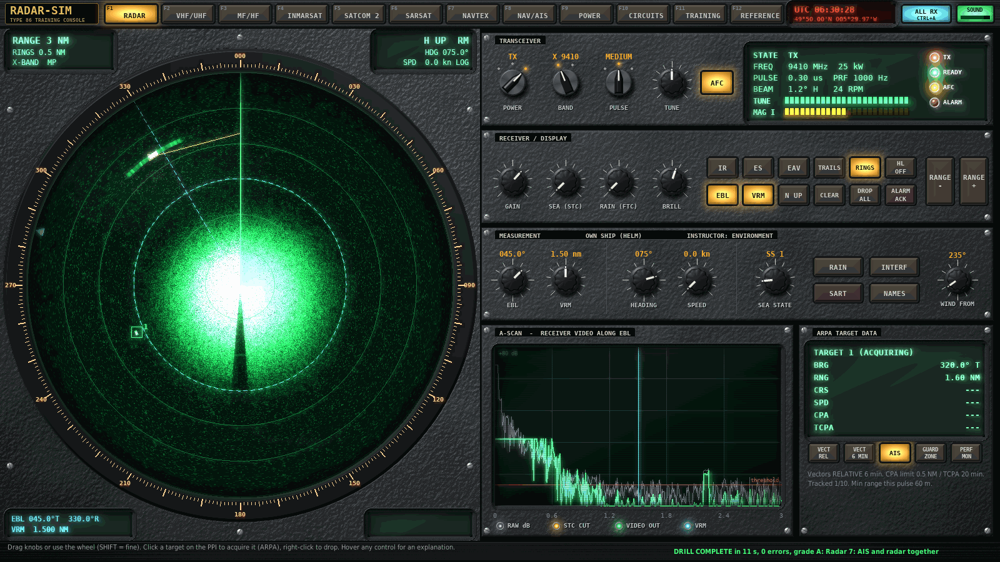
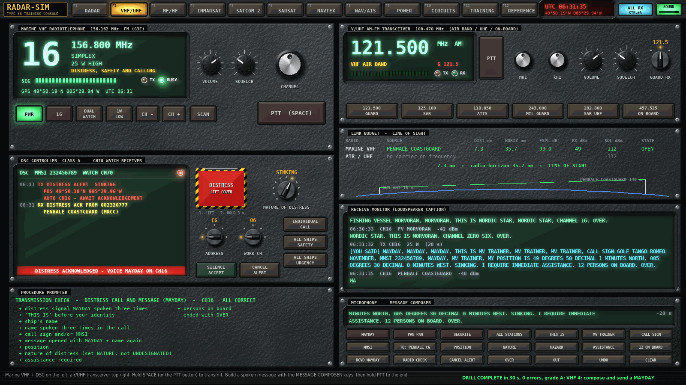
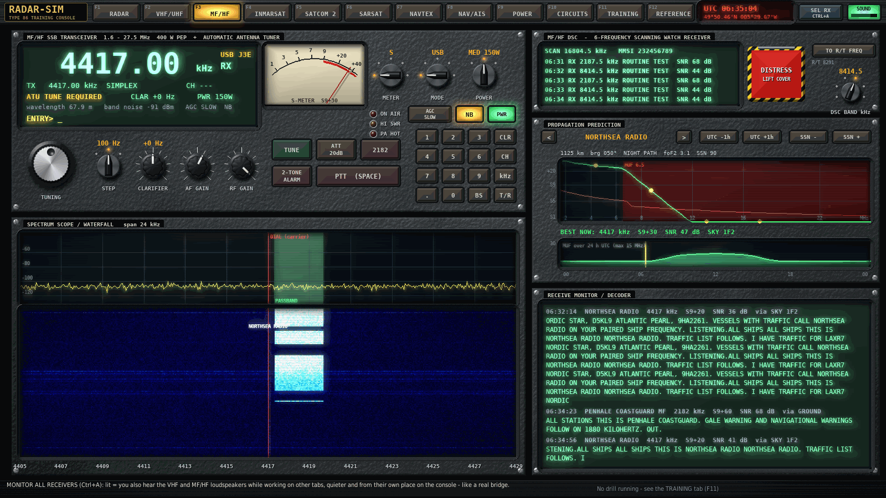
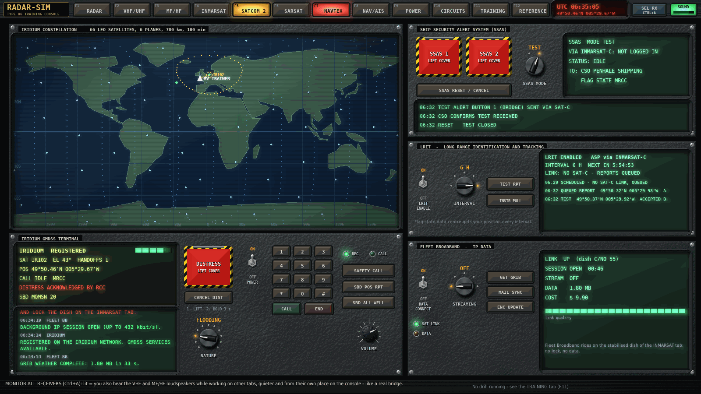
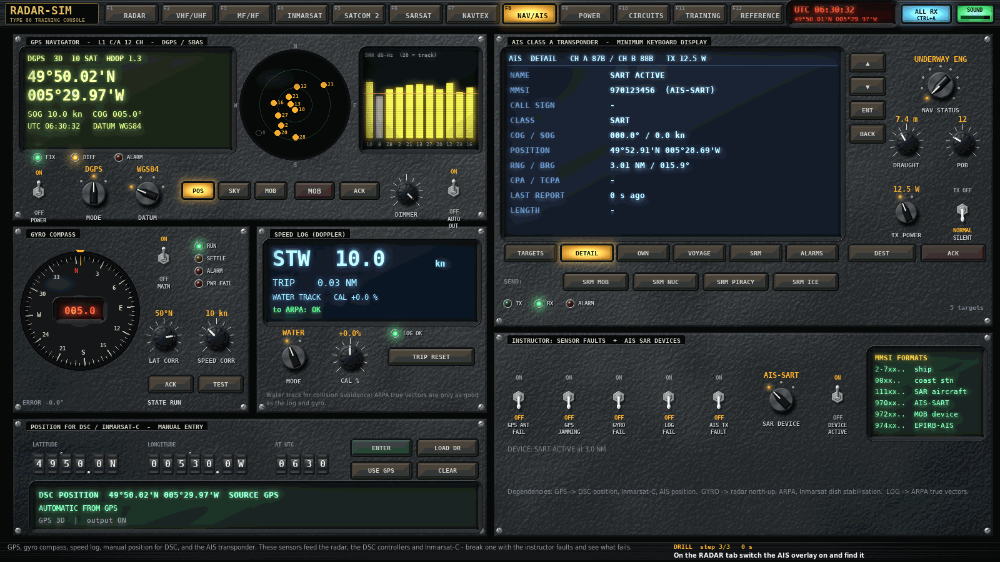
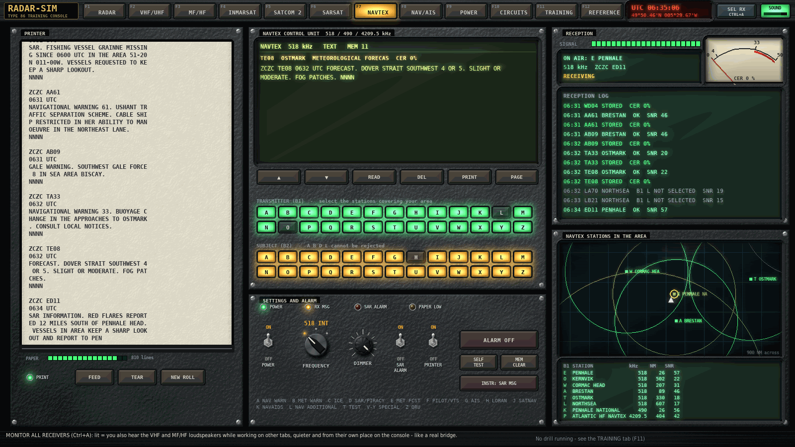
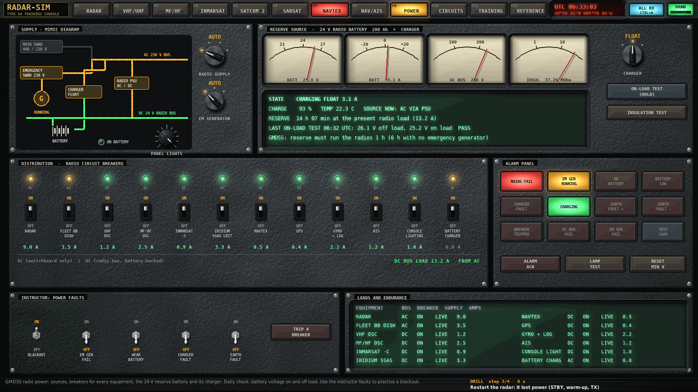
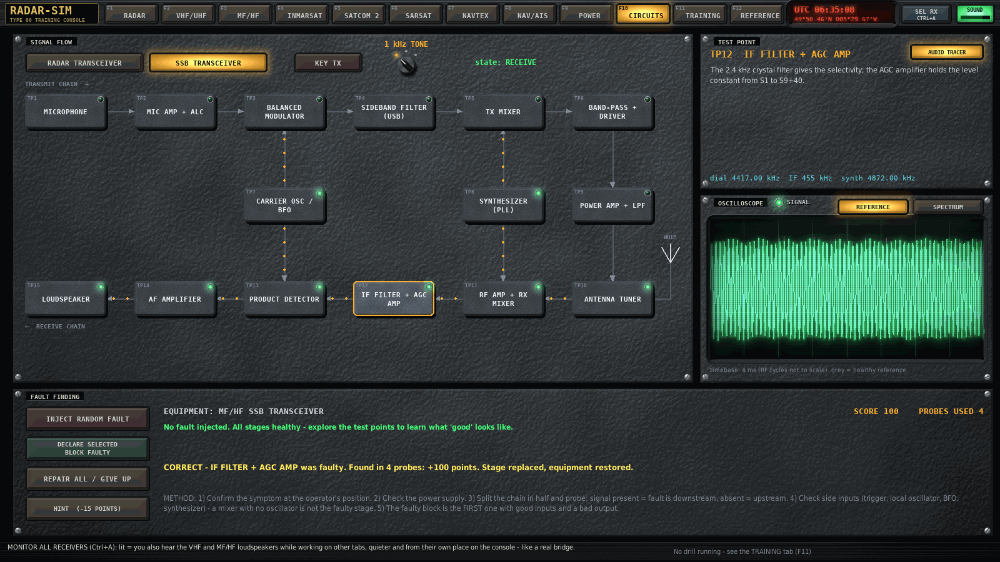
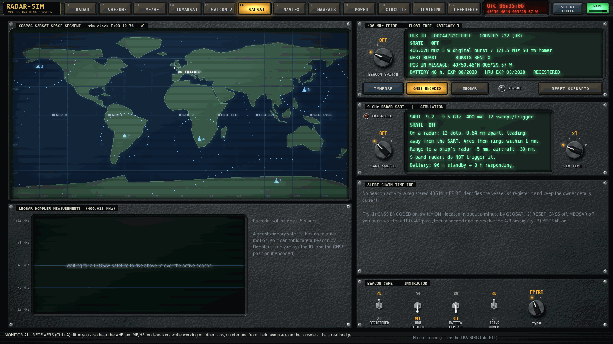

# RADAR-SIM

A 2D radar, radio and GMDSS console trainer written in Python (pygame + numpy).
Twelve equipment positions share one simulated ship and world, so what you do
on one panel shows up on the others: switch on the EPIRB and its 121.5 MHz
homer howls on the guard receiver; break the magnetron on the circuits bench
and the radar picture loses its echoes; trip the VHF breaker and the radio
goes dead; lose the GPS and every DSC alert goes out with "position unknown";
leave the gyro corrections wrong and every radar bearing is turned by the
gyro error.



## Run it

```
pip install -r requirements.txt
python run.py
```

## Linux AppImage

A Linux x86_64 AppImage is built automatically on pushes to `main`, version
tags, and pull requests. You can also start a build manually from the
[Build Linux AppImage workflow](https://github.com/nrobertson152/radar-sim/actions/workflows/appimage.yml).

To download a build, open a successful workflow run, then download the
**RADAR-SIM-linux-x86_64** artifact under **Artifacts**. Unzip it and run:

```bash
chmod +x RADAR-SIM-x86_64.AppImage
./RADAR-SIM-x86_64.AppImage
```

The artifact also includes a SHA-256 checksum. The AppImage bundles Python and
the application's pip dependencies; you do not need to install them separately.
If your system lacks the FUSE library required by the AppImage runtime, launch
it with `APPIMAGE_EXTRACT_AND_RUN=1 ./RADAR-SIM-x86_64.AppImage`.
Workflow artifacts are retained for 30 days.

Python 3.9+. `pygame-ce` is recommended; classic `pygame` 2.x also works.
The window is 1600x900 and scales when resized (Ctrl+F = full screen).
There are no asset files: the artwork is rendered and the sound synthesised
when the program starts.

## Look and sound

The console is drawn as physical 1980s hardware without a 3D engine.
`radarsim/fx.py` describes each part (panel plate, fluted knob, bar-pointer
switch, bat-handle toggle switch, moulded circuit breaker, thumbwheel, legend
push-button, jewelled lamp, annunciator window, guarded distress button,
display bezel, PPI housing) as a small height map plus a material and lights it
once with a fixed lamp above the console, then caches the result as an
ordinary 2D sprite. CRT and display faces are drawn live every frame and then
given phosphor bloom, scan lines, a shadow mask and a glass reflection. The
POWER panel's dimmer (or the console-lighting breaker) darkens the panels while
the displays keep glowing. Interaction is entirely 2D.

The sound is **stereo**. Every one-shot comes from where you clicked; each
equipment position has its own place on the console; the marine VHF speaker is
on the left of its panel and the air radio on the right. Radio audio goes
through a small-loudspeaker model and the mechanical sounds through a short
wheelhouse room response. With **ALL RX** on (Ctrl+A) you also hear the VHF and
MF/HF loudspeakers while working on other tabs, quieter and from their own
position - so channel 16 calls reach you on the radar, as on a real bridge.

Radio voices are real speech: eSpeak NG (bundled by the `espeakng-loader`
package, no system install) speaks each message with a per-station voice,
band-limited and compressed like a communications transmitter. On HF the clip
is kept as an analytic signal so tuning error produces a true SSB pitch shift
and the wrong sideband really inverts the speech. Your own composed VHF
messages are spoken in your ship's voice, satellite telephone calls are answered
by voice, and without the package the radios fall back to captions.

Everything makes a sound: detents, rotary switches, toggles and breakers,
thumbwheel ratchets, keyboards, printers, the distress covers, relays,
contactors, squelch crashes and tails, DSC and data bursts, DTMF, ring and busy
tones, satellite lock / unlock chimes and handoffs, alarms and buzzers, the
radar's degauss, high voltage and scanner motor running up, the modulator at
the PRF, the HF power amplifier's cooling fan and atmospheric static, the
emergency generator cranking, the ship's engine (following the speed you set),
wind and sea, rain on the windows, the steering gear, and the rescue
helicopter's rotor - panned by its bearing and Doppler-shifted as it arrives.

| Key | Action |
| --- | --- |
| F1 - F12, Ctrl+Tab | switch station |
| mouse drag / wheel | turn knobs and thumbwheels (SHIFT = fine) |
| left / right click on a selector | step it up / down |
| SPACE | push-to-talk on the VHF and MF/HF stations |
| Ctrl+M | mute |
| Ctrl+A | monitor all receivers (ALL RX / SEL RX) |
| PgUp / PgDn, wheel on SOUND | master volume |
| Ctrl+F, Alt+Enter | full screen |

Hover any control: the status bar explains what it does on the real equipment.
Operating errors (a distress alert with no position, an overheated PA, a
call without a satellite...) flash in the status bar and are listed in the
drill debrief.

## Stations

**F1 RADAR** - X/S-band marine radar. Every sweep is computed from the radar
equation: targets (R^-4, RCS, radar horizon), land with shadowing, sea clutter
(sea state, wind direction), rain clutter and attenuation, receiver noise,
side lobes, multiple and indirect false echoes from big ships close by, a blind
sector astern, main bang and minimum range. The receiver chain is modelled in
order: tuning against a drifting magnetron (TUNE or AFC), STC, gain/threshold,
FTC, echo stretch, averaging, interference rejection. Warm-up, scanner run-up,
three pulse lengths, nine ranges, head-up / north-up (needs the gyro),
EBL, VRM, trails, A-scan, performance monitor. ARPA only tracks what it can
see: acquisition needs an echo, targets are declared LOST after missed scans,
history dots, TRUE / RELATIVE vectors of 3, 6 or 12 minutes, CPA/TCPA alarm,
true vectors computed from the gyro and speed log. A guard zone driven by the
real video, an AIS overlay with reporting lag, SART, racon and the GPS
man-overboard mark.

**F2 VHF / UHF** - marine VHF radiotelephone with a Class-A DSC controller
(distress with nature, individual / safety / urgency calls, incoming routine
calls you accept onto a working channel, repetition and cancellation), dual
watch with real sampling gaps, scan, high/low power, plus a 108-470 MHz AM/FM
transceiver with guard receiver. A live line-of-sight link budget shows why
height beats power. The **message composer** builds a radiotelephone message
from standard phrases; hold PTT and it is spoken in your own voice (release
early and the rest is never sent). Your MAYDAY, PAN PAN, SECURITE, radio
check, false-alert cancellation or MAYDAY acknowledgement is checked
element by element and the coastguard answers what it actually heard -
including "say again your position". Ships on a collision course call you on
channel 16 and expect an answer.

**F3 MF / HF SSB** - synthesised SSB transceiver with keypad and ITU duplex
channels, clarifier, antenna tuner, S / power / SWR / current / PA temperature
meter, spectrum scope and waterfall, DSC watch receiver and an ionospheric
propagation predictor. AGC fast / slow / off really rides the gain (a strong
station quietens the hiss; off overloads), atmospheric static crashes garble
copy unless the noise blanker is on, sky-wave signals fade (QSB), and long
transmissions at high SWR overheat the PA until it folds back.

**F4 INMARSAT** - point a stabilised dish (by eye or by the audible PEAK TONE)
at the right ocean-region satellite, auto-track (needs the gyro), log in,
send Inmarsat-C messages and distress alerts, run the performance verification
link test, select the EGC NAVAREA, receive SafetyNET, and place voice calls -
the two-digit safety codes are answered by voice.

**F5 SATCOM 2** - a live 66-satellite Iridium constellation with handoffs
and polar coverage, the Iridium GMDSS terminal (distress alert with an RCC
voice call-back, safety calls, handset, SBD messages, SafetyCast MSI), the
covert Ship Security Alert System (operate / test, CSO responses), LRIT
position reporting with polls and intervals, and Fleet Broadband IP data that
only flows while the Inmarsat dish is locked.

**F6 COSPAS-SARSAT** - 406 MHz EPIRB, radar SART, LEOSAR / GEOSAR / MEOSAR,
Doppler location with the A/B ambiguity and the full alert chain, plus beacon
care faults: unregistered beacon, expired hydrostatic release, expired battery,
PLB versus EPIRB, 121.5 MHz homer.

**F7 NAVTEX** - dedicated 518 / 490 / 4209.5 kHz receiver: eight transmitters
broadcasting in time slots, B1 station and B2 subject selection (A, B, D and L
cannot be rejected), duplicate suppression, character errors from a ground-wave
range model, a dot-matrix printer you can feed and tear, message memory, SAR
alarm and a coverage map.

**F8 NAV / AIS** - GPS (sky view, SNR bars, cold start, datum, DGPS, jamming,
MOB), gyro compass (settling, real speed / latitude error), Doppler speed log
(calibration error into ARPA), manual position entry for DSC on thumbwheels,
and a Class-A AIS transponder (targets, details, own / voyage data, safety
related messages, silent mode, AIS-SART / MOB / EPIRB-AIS devices).

**F9 POWER** - GMDSS radio power: mimic diagram, main / emergency / battery
changeover, an emergency generator that cranks and starts on a blackout, a
breaker for every equipment position, the 24 V reserve battery with charger,
on-load test and insulation test, an annunciator alarm panel, and instructor
faults (blackout, generator failure, weak battery, charger and earth faults,
tripped breaker).

**F10 CIRCUITS** - block diagrams of the radar and SSB transceivers with an
oscilloscope / spectrum probe and an audio signal tracer on every stage, a
healthy reference trace, hints, and a fault-finding game whose faults break the
real stations.

**F11 TRAINING** - 34 guided drills that set up a scenario, check each step
live on the real controls and grade you on time and operating errors - from
"switch on, tune and set gain" to a blackout, a composed MAYDAY, an SSAS test
and an abandon-ship capstone that uses every station.

**F12 REFERENCE** - GMDSS frequencies, voice procedure, radar and radio theory,
satellite systems, AIS / NAVTEX / sensors, power / security / Iridium.










## Tests

```
python tests/test_drills.py      # plays the original drills and every fault headless
python tests/test_features.py    # plays every new drill and checks the new systems
python tests/test_input.py       # mouse / keyboard event paths
python run.py --selftest shots   # screenshot of every station (and an audio check)
```

## Scope and accuracy

Frequencies, channel plans, procedures and equipment behaviour follow the
GMDSS as generally taught, but the physics is deliberately simplified
(for example a single-layer ionosphere, circular satellite orbits and a
compressed NAVTEX schedule), the coastline, ships, coast and NAVTEX stations
are fictional, and timings such as the magnetron warm-up and gyro settling are
shortened. It is a study aid, not a certified simulator and not a substitute
for the equipment manuals or an approved GOC/ROC course.

## Layout

```
radarsim/
  main.py       window, tabs, stereo mixing      world.py     ships, coast, traffic, AIS, propagation, orbits
  ui.py         knobs, switches, toggles, meters audio.py     synthesis, speakers, room, one-shots
  fx.py         lit hardware sprites, CRT glass  ambience.py  engine, weather, rain, helicopter, steering
  speech.py     spoken radio traffic (eSpeak NG) composer.py  VHF message composer and checking
  radar.py      F1    vhf.py      F2    hf.py      F3    satcom.py  F4    sat2.py     F5
  sarsat.py     F6    navtex.py   F7    nav.py     F8    power.py   F9    bench.py    F10
  training.py   F11   reference.py F12  worldmap.py, radiocore.py   shared helpers
```

Licensed under GPL-3.0 (see LICENSE).
